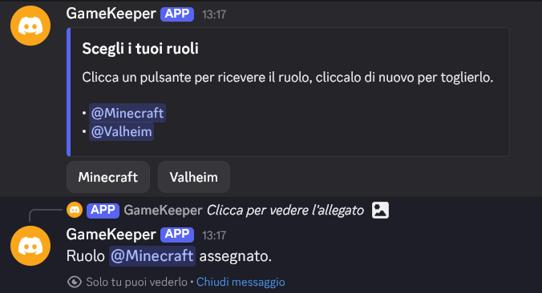
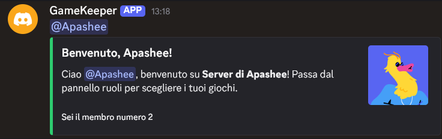
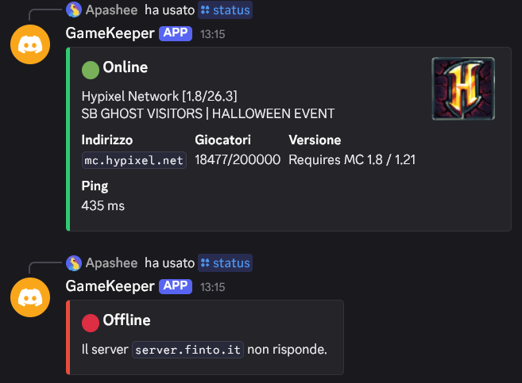
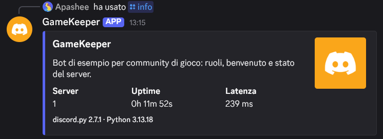

# GameKeeper: Discord bot for gaming communities

An example bot for gaming community Discord servers: slash commands, button roles,
welcome messages and Minecraft server status. Written in Python with
[discord.py](https://github.com/Rapptz/discord.py), it starts with a single command thanks to Docker.

| Button roles | Welcome new members |
|---|---|
|  |  |

| Minecraft server status | Bot info |
|---|---|
|  |  |

## Features

| Command / event | What it does | Who can use it |
|---|---|---|
| `/ping` | Replies with the bot's latency | Everyone |
| `/info` | Bot name, servers, uptime and latency | Everyone |
| `/roles` | Posts a panel with one button per role (up to 5): click to get the role, click again to remove it | Members who can manage roles |
| New member | Welcome message with avatar in the configured channel | Automatic |
| `/welcome-test` | Sends the welcome message for yourself, to preview it | Members who can manage the server |
| `/status [address]` | Minecraft Java server status: online/offline, players, version, ping, icon | Everyone |

Role buttons keep working after the bot restarts, with no database:
the role ID is stored in the button itself.

## 1. Create the bot in the Developer Portal

1. Go to <https://discord.com/developers/applications> and click **New Application**.
2. On the **Bot** page:
   - click **Reset Token** and copy the token (it's a password: never share it);
   - under *Privileged Gateway Intents* enable **Server Members Intent** (needed for welcome messages);
   - leave *Requires OAuth2 Code Grant* **off**.
3. On **OAuth2 → URL Generator** select the `bot` and `applications.commands` scopes
   and the *View Channels*, *Send Messages*, *Embed Links*, *Manage Roles* permissions.
   Open the generated link and invite the bot to your server.
4. In your server settings, under **Roles**, drag the bot's role **above** the roles it
   should assign: Discord only lets a bot manage roles below its own.

## 2. Configuration

```bash
cp .env.example .env
```

| Variable | Required | Description |
|---|---|---|
| `DISCORD_TOKEN` | Yes | Bot token |
| `GUILD_ID` | No | Server ID: commands show up there instantly instead of after global propagation |
| `WELCOME_CHANNEL_ID` | No | ID of the welcome channel |
| `WELCOME_MESSAGE` | No | Welcome text; `{user}` = member mention, `{server}` = server name |
| `MC_HOST` / `MC_PORT` | No | Default Minecraft server for `/status` (default port 25565) |

To copy IDs, enable *Settings → Advanced → Developer Mode* in Discord,
then right-click a server or channel → **Copy ID**.

## 3. Running

### With Docker (recommended)

```bash
docker compose up -d --build   # build the image and start the bot in the background
docker compose logs -f         # follow the logs
docker compose down            # stop the bot
```

The container restarts automatically on errors and after a reboot
(`restart: unless-stopped`) and runs as an unprivileged user.

### Without Docker

Requires Python 3.11 or later.

```bash
python3 -m venv .venv
.venv/bin/pip install -r requirements.txt
.venv/bin/python -m bot.main
```

## Project structure

```
bot/
├── main.py          # startup, cog loading, command sync
├── config.py        # settings read from .env
└── cogs/            # one module per feature
    ├── general.py   # /ping, /info
    ├── roles.py     # /roles and buttons
    ├── welcome.py   # welcome message and /welcome-test
    └── status.py    # /status for Minecraft
```

To add a feature, create a new file in `bot/cogs/` and add it to the
`EXTENSIONS` list in `bot/main.py`.

## Security

The `.env` file is excluded from git and from the Docker image: the token never ends up
in the repository. If a token is ever exposed, regenerate it right away with **Reset Token**.
